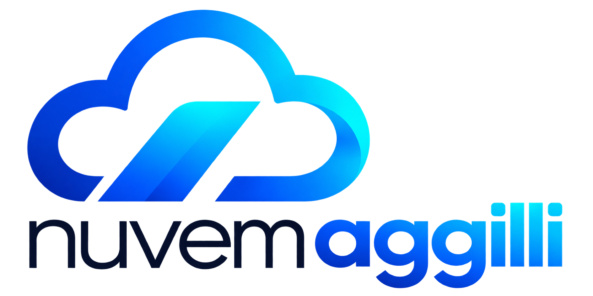

# Nuvem Aggilli

Branding versionado da instalação existente do Nextcloud: logo transparente, nome, assinatura e cor aplicados em produção em 1 de novembro de 2026.



A fonte de referência é [config/branding.json](config/branding.json). O PNG desse manifesto é exatamente o arquivo servido pelos campos `logo` e `logoheader` no deploy registrado, verificado por SHA-256.

## Verificar antes e depois de uma atualização

Requer Python 3.9 ou superior, sem dependências adicionais:

```bash
python3 scripts/check_branding.py
python3 scripts/check_branding.py --remote
```

O primeiro comando verifica os arquivos locais. `--remote` acrescenta consultas HTTPS públicas ao login e às duas imagens, sem autenticação ou escrita. Para homologação:

```bash
python3 scripts/check_branding.py --remote --base-url https://SEU-DOMINIO-DE-HOMOLOGACAO
```

Uma falha indica divergência ou problema de acesso a investigar; não dispara deploy nem reparação automática. A verificação não substitui os testes de login, upload, download, compartilhamento e sincronização.

## Documentação

- [Identidade e assets](docs/BRAND_IDENTITY.md).
- [Aplicação e rollback](docs/BRANDING_DEPLOY.md).
- [Procedimento para atualizar o Nextcloud](docs/UPDATE_RUNBOOK.md).
- [Estado observado e limites da validação](docs/PRODUCTION_STATE.md).
- [Origem e tratamento da imagem](docs/ASSET_PROVENANCE.md).
- [Histórico](CHANGELOG.md).

## Escopo

Este repositório contém o branding; não contém a aplicação completa, o Compose de produção, o banco, os dados, as credenciais nem os backups. Não reconstrói sozinho a infraestrutura existente e não configura deploy automático. A integração com a versão atual usa `occ theming:config`, sem modificar o core do Nextcloud.

Os tokens CSS registram a direção visual. A folha não foi instalada em produção; fonte, fundo e favicon não fazem parte do deploy registrado. Atualizações futuras precisam de backup operacional, homologação e autorização própria. Versionamento reduz perda de configuração, mas não garante ausência de regressões.
